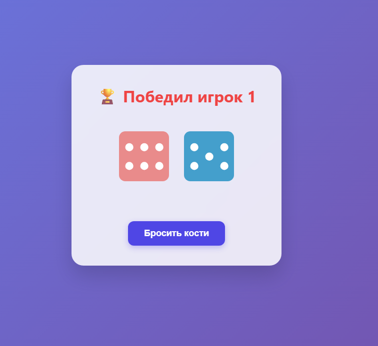

# 🎲 Dice Game (Игра в кости)

Мини-игра на чистом JavaScript, где два игрока бросают кости, а победитель определяется случайным образом.

## 🚀 Демо
Посмотреть игру вживую можно здесь: **https://tsvezh.github.io/dice-game/**

## 🛠 Технологии
* HTML5
* CSS3 (Flexbox, CSS-анимации)
* JavaScript (ES6+, DOM API)

## ✨ Функционал
* Генерация случайных чисел от 1 до 6
* Динамическая отрисовка SVG-спрайтов
* Определение победителя (игрок 1, игрок 2 или ничья)
* Анимация броска кубиков

* 📸 Скриншот

